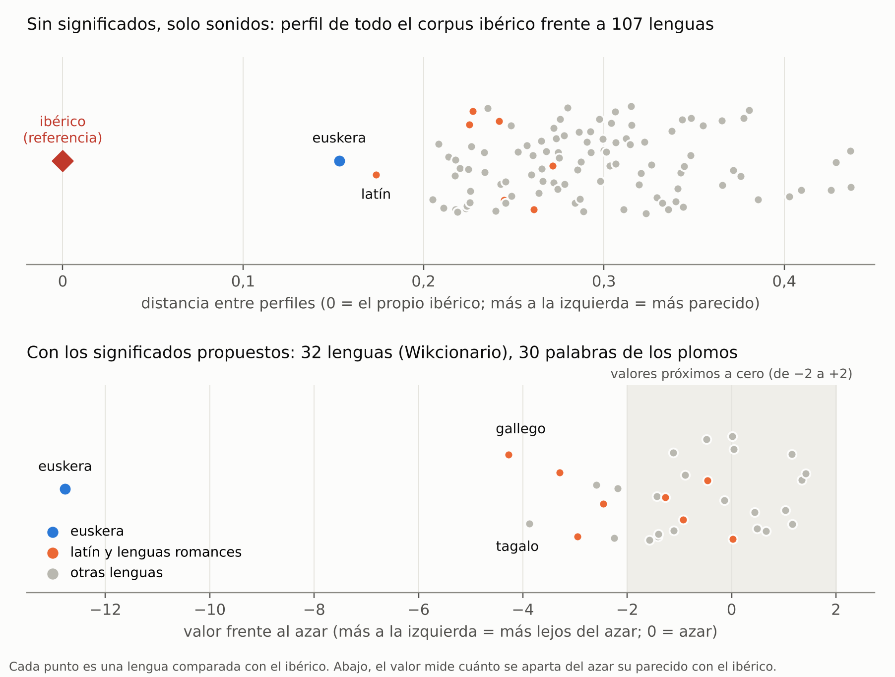

# El léxico de los plomos ibéricos ante 107 lenguas: una comparación estadística en la que el euskera ocupa el primer lugar

*Repositorio de réplica (datos, programas, especificación y resultados).*

*English version: `README.md`.*

**Artículo:** Martín Valladolid, D. (2026). *El léxico de los plomos ibéricos ante 107 lenguas: una comparación estadística en la que el euskera ocupa el primer lugar* (ediciones inglesa y española). Zenodo. [https://doi.org/10.5281/zenodo.24443588](https://doi.org/10.5281/zenodo.24443588) · Web: [iberico.martinva.org](https://iberico.martinva.org)

[](https://doi.org/10.5281/zenodo.24443588) Software (datos y programas): [](https://doi.org/10.5281/zenodo.24446155)

[](https://github.com/martinva/iberian-lexicon-107-languages/actions/workflows/comprobacion.yml) [](https://github.com/martinva/iberian-lexicon-107-languages/actions/workflows/cldf.yml)
[](https://colab.research.google.com/github/martinva/iberian-lexicon-107-languages/blob/main/reproduce_results.ipynb) — ejecutar todo en el navegador, sin instalar nada.



*Figura 1. Arriba, a ciegas respecto a cualquier traducción propuesta: distancia entre el perfil de sonidos de todo el corpus ibérico (en el 0) y cada una de 107 lenguas. Abajo, con los significados propuestos: valor de cada lengua frente al azar con las 30 unidades de los plomos. El euskera, en azul. Dibujada por `4_programas/figura_v48_dos_pruebas.py` con los resultados de este repositorio.*

> **Edición pública.** Las fuentes con derechos de terceros se distribuyen aquí solo como listas derivadas mínimas: Hesperia, como formas reducidas a clases de sonidos por ficha (`1_fuentes_lexicas/iberico/hesperia_formas_reducidas.json`, sin el texto de las inscripciones); Azkue, como lema y equivalentes castellanos; Trask, como formas reconstruidas y glosas. Todos los programas que usan `ibcomp.fuentes.hesperia()` dan resultados idénticos; los cuatro que leen el texto mismo de las inscripciones (`t01_t02_corpus.py`, `t28`, `t29` y parte de `comprobacion_rapida.py`) necesitan los archivos originales de Hesperia, que `1_fuentes_lexicas/iberico/descargar_hesperia.py` descarga y verifica byte a byte. Este repositorio público empieza sin el historial del repositorio privado de trabajo; las fechas de las declaraciones previas figuran en `docs/HISTORIAL_DECLARACIONES.md`.

Repositorio de réplica del artículo «El léxico de los plomos ibéricos ante 107 lenguas: una comparación estadística en la que el euskera ocupa el primer lugar» (D. Martín Valladolid). Datos, criterios, algoritmos, programas y especificación del estudio. Todo lo necesario para repetir los cálculos y para auditarlos.

## Contenido

| Carpeta | Qué hay |
|---|---|
| `1_fuentes_lexicas/` | Todos los datos. Ficha de cada fuente en `LEEME_fuentes.md` |
| `2_criterios/` | Criterios del estudio y su justificación; fichas de procedencia de cada significado (`FICHAS_procedencia.md`) |
| `3_algoritmos/` | El protocolo (`PROTOCOLO.md`), una ficha por modelo estadístico (por qué se eligió, respaldo, usos paralelos y resultados) y los algoritmos, con su formulación y un ejemplo |
| `4_programas/` | Un programa por tabla del artículo y el paquete común `ibcomp` |
| `5_especificacion/` | Especificación funcional detallada, en español y en inglés: permite rehacer los programas sin ver el código |
| `resultados/` | Salida de cada programa y comparación con las cifras del artículo |

## Cómo repetir los cálculos

Se necesita Python 3.10 o posterior y las bibliotecas NumPy y, solo para las figuras, Matplotlib (`pip install -r requirements.txt`). Entorno de referencia en el que se obtuvieron los resultados publicados: Python 3.13.18, NumPy 2.5.3, Linux x86-64; un auditor independiente los reprodujo con exactitud con Python 3.13.5 y NumPy 2.3.5. Con otras versiones los valores que dependen de sorteos deberían coincidir, pero no se garantiza identidad bit a bit entre plataformas.

Antes de nada, el corpus ibérico. Los dos archivos con el texto y los metadatos de las inscripciones de Hesperia no se redistribuyen (Hesperia es la fuente): se descargan de Hesperia con un programa que reproduce exactamente la consulta del artículo y comprueba, por suma SHA-256, que el resultado es el mismo (unos 40 minutos; solo biblioteca estándar). Sin ellos funcionan todas las pruebas salvo las tablas 1, 2, 8 y 14 y la calibración del perfil (`t22`), que también lee el corpus.

```
cd 1_fuentes_lexicas/iberico
python3 descargar_hesperia.py
cd ../..
```

Después, la comprobación rápida (menos de un minuto): verifica que los datos están completos y que los resultados que no dependen de sorteos coinciden.

```
cd 4_programas
python3 comprobacion_rapida.py
```

Después, cada programa:

```
cd 4_programas
python3 t01_t02_corpus.py
python3 t04_t05_numerales.py
python3 t06_t07_significados.py
python3 t08_perfil.py
python3 t09_prestamos.py
python3 s82_formas_y_sinonimos.py
python3 t10_controles.py
python3 t11_t13_estables.py
python3 t14_zonas.py
python3 t15_solidez_unidades.py
python3 t16_contraste_principal.py
python3 t18_perfil_contacto.py
python3 t19_potencia_controles.py
python3 t17_techo_circularidad.py
python3 a3_comprobacion_medida.py
python3 figuras.py
```

Cada programa escribe en `resultados/` un archivo con su mismo nombre. Los tiempos van de unos segundos a algo más de una hora.

## Qué programa corresponde a cada resultado

| Resultado del artículo | Programa |
|---|---|
| Tablas 1 y 2: el corpus por soporte | `t01_t02_corpus.py` |
| Tablas 4 y 5: serie numeral | `t04_t05_numerales.py` |
| Tablas 6 y 7: prueba con significados | `t06_t07_significados.py` |
| Tabla 8: perfil de combinaciones de sonidos | `t08_perfil.py` |
| Tabla 9: con los préstamos latinos y sin ellos | `t09_prestamos.py` |
| Apartado 8.2: formas flexionadas y sinónimos | `s82_formas_y_sinonimos.py` |
| Tabla 10: lenguas de control | `t10_controles.py` |
| Tablas 11 a 13: significados estables y poco estables | `t11_t13_estables.py` |
| Tabla 14: proximidad por zonas | `t14_zonas.py` |
| Tabla 10 bis y apartado 8.4: solidez frente a la lista de unidades | `t15_solidez_unidades.py` |
| Tabla 10 ter y apartado 8.5: contraste principal (permutación de los significados, corrección por el número de lenguas) | `t16_contraste_principal.py` |
| Tabla 15 y apartado 11.3: perfil de sonidos en parejas de lenguas con préstamo intenso | `t18_perfil_contacto.py` |
| Apartado 8.3: potencia y falsos positivos con 100 muestras por lengua de control | `t19_potencia_controles.py` |
| Apartado 8.4: ensayo sobre la circularidad (no concluyente) | `t17_techo_circularidad.py` |
| Anexo B.7: variación entre semillas (40 repeticiones; unas tres horas) | `t20_variacion_semillas.py` |
| Tabla 10 bis, sin las unidades con lectura alternativa | `t21_lecturas_alternativas.py` |
| Tabla 8, calibración de la distancia entre perfiles | `t22_calibracion_perfil.py` |
| Apartado 8.4, tamaño de los diccionarios | `t23_tamano_diccionario.py` |
| Tabla 10 bis con la clasificación del jurado ciego (`2_criterios/jurado/respuestas/`) | `t24_jurado_procedencia.py` |
| Apartado 11.4, regularidad de las correspondencias | `t25_correspondencias.py` |
| Apartado 11.5, gradiente de prestabilidad (WOLD) | `t26_prestabilidad.py` |
| Apartado 11.6, origen etimológico y fonotaxis de las candidatas vascas | `t27_etimologia_vasca.py [amplia]` |
| Segundo artículo: predicción prospectiva (declaración 13) | `t28_prediccion_prospectiva.py preparar/puntuar` |
| Apartado 8.4: reclasificación de la Monografía IV (declaración 16) | `t31_reclasificacion_m4.py` |
| Segundo artículo: sufijos (declaración 12) | `t29_sufijos.py preparar/puntuar` |
| Segundo artículo: cloze, control de memoria (declaración 14) | `t30_cloze.py preparar/puntuar` |
| Anexo A.3: comprobación de la medida | `a3_comprobacion_medida.py` |
| Figuras 1 a 3 (dibuja resultados ya calculados; requiere Matplotlib) | `figuras.py` |

## Réplica independiente

Quien quiera comprobar el estudio sin usar estos programas puede partir de `5_especificacion/ESPECIFICACION_FUNCIONAL_es.md` y de las fuentes públicas enumeradas en `1_fuentes_lexicas/LEEME_fuentes.md`. Los resultados que no dependen de sorteos deben coincidir exactamente; los demás, dentro del margen que se indica en `resultados/RESULTADOS_ESPERADOS.md`.

## Lenguas de la documentación

Los documentos están en español y en inglés (`*_en.md`, `README.md`). Los nombres de archivos, carpetas y funciones están en español. En caso de duda prevalece la versión española.

## Licencia y cita

Véanse `LICENSE.md` (programas: MIT; textos y datos propios: CC BY 4.0; datos de terceros: los de su fuente) y `CITATION.cff`.
