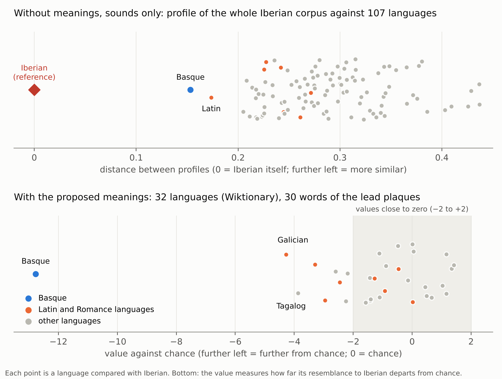

# The Lexicon of the Iberian Lead Plaques Compared with 107 Languages: A Statistical Comparison in Which Basque Ranks First

*Replication repository (data, programs, specification and results).*

*Versión española: `LEEME.md`.*

**Article:** Martín Valladolid, D. (2026). *The Lexicon of the Iberian Lead Plaques Compared with 107 Languages: A Statistical Comparison in Which Basque Ranks First* (EN and ES editions). Zenodo. [https://doi.org/10.5281/zenodo.24443589](https://doi.org/10.5281/zenodo.24443589) · Web: [iberico.martinva.org](https://iberico.martinva.org)

[](https://doi.org/10.5281/zenodo.24443589)

[](https://github.com/martinva/iberian-lexicon-107-languages/actions/workflows/comprobacion.yml) [](https://github.com/martinva/iberian-lexicon-107-languages/actions/workflows/cldf.yml)
[](https://colab.research.google.com/github/martinva/iberian-lexicon-107-languages/blob/main/reproduce_results.ipynb) — run everything in the browser, nothing to install.



*Figure 1. Top, blind to any proposed translation: distance between the sound profile of the whole Iberian corpus (at 0) and each of 107 languages. Bottom, with the proposed meanings: value of each language against chance with the 30 units of the lead plaques. Basque in blue. Drawn by `4_programas/figuras_en_v48.py` from the results in this repository.*

> **Public edition.** Sources with third-party rights are distributed here only as minimal derived lists: Hesperia as sound-class-reduced forms per record (`1_fuentes_lexicas/iberico/hesperia_formas_reducidas.json`, no inscription text), Azkue as headword + Spanish equivalents, Trask as reconstructed forms + glosses. All programs that use `ibcomp.fuentes.hesperia()` give identical results; the four programs that read the inscription text itself (`t01_t02_corpus.py`, `t28`, `t29` and part of `comprobacion_rapida.py`) need the original Hesperia files, which `1_fuentes_lexicas/iberico/descargar_hesperia.py` downloads and verifies byte by byte. This public repository starts without the history of the private working repository; the dates of the prior declarations are listed in `docs/HISTORIAL_DECLARACIONES.md`.

Replication repository of the article "The Lexicon of the Iberian Lead Plaques Compared with 107 Languages: A Statistical Comparison in Which Basque Ranks First" (D. Martín Valladolid; Spanish original: «El léxico de los plomos ibéricos ante 107 lenguas: una comparación estadística en la que el euskera ocupa el primer lugar»). Data, criteria, algorithms, programs and specification of the study. Everything needed to repeat the calculations and to audit them.

## Contents

| Folder | What it holds |
|---|---|
| `1_fuentes_lexicas/` | All the data (lexical sources). A record for each source in `README_sources_en.md` |
| `2_criterios/` | Criteria of the study and their justification (`CRITERIA_en.md`); provenance record of each meaning (`PROVENANCE_RECORDS_en.md`) |
| `3_algoritmos/` | The protocol (`PROTOCOL_en.md`), a record for each statistical model (`MODELS_choice_backing_uses_and_results_en.md`) and the algorithms, with their formulation, an example and their backing in the literature (`ALGORITHMS_AND_BACKING_en.md`) |
| `4_programas/` | One program per table of the article, and the common package `ibcomp` |
| `5_especificacion/` | Detailed functional specification, in Spanish and English: allows the programs to be rebuilt without seeing the code (`FUNCTIONAL_SPECIFICATION_en.md`) |
| `resultados/` | Output of each program and comparison with the figures of the article |

## How to repeat the calculations

Python 3.10 or later and the libraries NumPy and, for the figures only, Matplotlib (`pip install -r requirements.txt`). Reference environment in which the published results were obtained: Python 3.13.18, NumPy 2.5.3, Linux x86-64; an independent auditor reproduced them exactly with Python 3.13.5 and NumPy 2.3.5. With other versions the values that depend on draws should match, but bit-for-bit identity across platforms is not guaranteed.

First of all, the Iberian corpus. The two files with the text and the metadata of the Hesperia inscriptions are not redistributed (Hesperia is the source): they are downloaded from Hesperia with a program that reproduces exactly the query of the article and checks, by SHA-256 sum, that the result is the same (about 40 minutes; standard library only). Without them every test runs except Tables 1, 2, 8 and 14 and the profile calibration (`t22`), which also reads the corpus.

```
cd 1_fuentes_lexicas/iberico
python3 descargar_hesperia.py
cd ../..
```

Then, the quick check (under a minute): it verifies that the data are complete and that the results which do not depend on random draws match.

```
cd 4_programas
python3 comprobacion_rapida.py
```

Then each program:

```
python3 t01_t02_corpus.py
python3 t04_t05_numerales.py
python3 t06_t07_significados.py
python3 t08_perfil.py
python3 t09_prestamos.py
python3 s82_formas_y_sinonimos.py
python3 t10_controles.py
python3 t11_t13_estables.py
python3 t14_zonas.py
python3 t15_solidez_unidades.py
python3 t16_contraste_principal.py
python3 t18_perfil_contacto.py
python3 t19_potencia_controles.py
python3 t17_techo_circularidad.py
python3 a3_comprobacion_medida.py
python3 figuras.py
```

Each program writes to `resultados/` a file of the same name. Expected values: `resultados/EXPECTED_RESULTS_en.md`. Running times range from a few seconds to somewhat over an hour.

## Which program corresponds to each result

| Result in the article | Program |
|---|---|
| Tables 1 and 2: the corpus by medium | `t01_t02_corpus.py` |
| Tables 4 and 5: numeral series | `t04_t05_numerales.py` |
| Tables 6 and 7: meaning-based test | `t06_t07_significados.py` |
| Table 8: sound-combination profile | `t08_perfil.py` |
| Table 9: with and without the Latin loans | `t09_prestamos.py` |
| Section 8.2: inflected forms and synonyms | `s82_formas_y_sinonimos.py` |
| Table 10: control languages | `t10_controles.py` |
| Tables 11 to 13: stable and less stable meanings | `t11_t13_estables.py` |
| Table 14: proximity by zones | `t14_zonas.py` |
| Table 10 bis and section 8.4: robustness to the list of units | `t15_solidez_unidades.py` |
| Table 10 ter and section 8.5: main analysis (permutation of meanings, correction for the number of languages) | `t16_contraste_principal.py` |
| Table 15 and section 11.3: sound profile in pairs of languages with heavy borrowing | `t18_perfil_contacto.py` |
| Section 8.3: power and false positives with 100 samples per control language | `t19_potencia_controles.py` |
| Section 8.4: trial on circularity (inconclusive) | `t17_techo_circularidad.py` |
| Annex B.7: variation between seeds (40 repetitions; about three hours) | `t20_variacion_semillas.py` |
| Table 10 bis, without the units with an alternative reading | `t21_lecturas_alternativas.py` |
| Table 8, calibration of the profile distance | `t22_calibracion_perfil.py` |
| Section 8.4, dictionary size | `t23_tamano_diccionario.py` |
| Table 10 bis with the blind panel's classification (`2_criterios/jurado/respuestas/`) | `t24_jurado_procedencia.py` |
| Section 11.4, regularity of correspondences | `t25_correspondencias.py` |
| Section 11.5, borrowability gradient (WOLD) | `t26_prestabilidad.py` |
| Section 11.6, etymological status and phonotactics of the Basque candidates | `t27_etimologia_vasca.py [amplia]` |
| Second article: prospective prediction (declaration 13) | `t28_prediccion_prospectiva.py preparar/puntuar` |
| Section 8.4: Monograph IV reclassification (declaration 16) | `t31_reclasificacion_m4.py` |
| Second article: suffixes (declaration 12) | `t29_sufijos.py preparar/puntuar` |
| Second article: cloze, memory control (declaration 14) | `t30_cloze.py preparar/puntuar` |
| Annex A.3: check of the measure | `a3_comprobacion_medida.py` |
| Figures 1 to 3 (draws results already computed; requires Matplotlib) | `figuras.py` |

## Independent replication

Anyone wishing to check the study without using these programs can start from `5_especificacion/FUNCTIONAL_SPECIFICATION_en.md` and from the public sources listed in `1_fuentes_lexicas/README_sources_en.md`. Results that do not depend on random draws must match exactly; the others, within the margin stated in `resultados/EXPECTED_RESULTS_en.md`.

## Languages of the documentation

Documents are in Spanish and English (`*_en.md`, `README.md`). File, folder and function names are in Spanish. In case of doubt the Spanish version prevails.

## Companion Monographs & Source Inventory (v5.2)

The meanings of the 30 lead-plaque units come from the four monographs of the series (edition v5.2). Each DOI below is the Zenodo concept DOI («Cite all versions»): it always resolves to the latest published version.

| Work | Concept DOI |
|---|---|
| Monograph I: accounting formulae, obligation vocabulary and patrimonial units | [10.5281/zenodo.23610039](https://doi.org/10.5281/zenodo.23610039) |
| Monograph II: rural estates, agrarian taxation and registration documents | [10.5281/zenodo.23612741](https://doi.org/10.5281/zenodo.23612741) |
| Monograph III: ownership, partnerships and bilateral clauses | [10.5281/zenodo.23614005](https://doi.org/10.5281/zenodo.23614005) |
| Monograph IV: synthesis, phonology and comparative evaluation | [10.5281/zenodo.23617694](https://doi.org/10.5281/zenodo.23617694) |
| Complete English edition (Monographs I–IV) | [10.5281/zenodo.23620146](https://doi.org/10.5281/zenodo.23620146) |
| Executive synthesis (EN / ES / DE) | [10.5281/zenodo.23677389](https://doi.org/10.5281/zenodo.23677389) |

The provenance of each meaning (level, source, whether a Basque comparison was involved) is listed unit by unit in Annex D of the article and in `2_criterios/`.

## Licence and citation

See `LICENSE.md` (programs: MIT; own texts and data: CC BY 4.0; third-party data: those of their source) and `CITATION.cff`.
